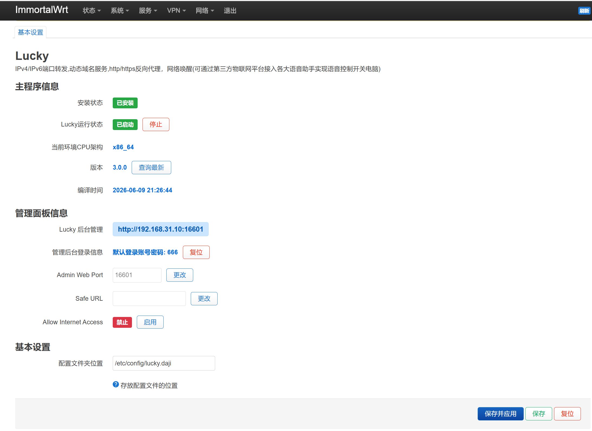

# luci-app-lucky (APK Build)

[](https://github.com/FloatingDream528/luci-app-lucky/actions/workflows/build-apk.yml)
[](https://github.com/FloatingDream528/luci-app-lucky/releases)
[](https://opensource.org/licenses/GPL-3.0)

这是 [Lucky](https://github.com/gdy666/lucky) 的 OpenWrt LuCI 控制面板及预编译核心打包仓库，专为采用全新 `apk` 包管理器的现代 OpenWrt 系统（25.12+）设计。

本仓库特性：
- 🤖 **每日追更**：每天自动巡查 [Lucky 官方发布站](https://release.66666.host/)，一旦有新版本立即自动构建并发版。
- 📦 **开箱即用**：所有发布的 `.apk` 包已**内置预编译核心文件**（`/usr/bin/lucky`），安装或启动服务时**无需再次在线下载核心**。
- ⚡ **原生纯客户端 JS 架构**：移除旧版 Lua CBI 与厚重的 `luci-compat` 依赖，离线安装包真正零额外兼容层依赖，原生适配浅色/深色主题。
- 🛠 **多架构矩阵构建**：通过 GitHub Actions 自动编译主流路由器平台架构。

> ⚠️ **注意**：这里的 APK 指的是 Alpine/OpenWrt 新版包管理器使用的 `.apk` 软件包格式，**不是 Android 的 APK**！

## 🚀 支持的架构对照表

目前 Release 页面提供以下架构的独立构建（可通过在路由器终端执行 `apk --print-arch` 查询当前架构）：

| 构建架构 (Zip 后缀) | 说明 / 常见设备代表 |
| :--- | :--- |
| `x86_64` | Intel / AMD 64位软路由 (X86) |
| `aarch64_generic` | ARM 64位软路由/盒子 (如 R2S/R4S、树莓派等通用 ARMv8 平台) |
| `arm_cortex-a7_neon-vfpv4` | ARMv7 设备 (如 竞斗云、极路由X、IPQ40xx 系列等) |
| `mips_24kc` | MIPS 大端设备 (如 Atheros AR9344 等) |
| `mipsel_24kc` | MIPS 小端设备 (如 MTK MT7620、MT7621、新路由3 等) |
| `i386_pentium4` | 老款 32位 软路由 |

---

## 🛠 安装指南 (极其重要)

### 为什么不能在网页上直接上传安装？
请勿使用 LuCI 网页后台的「系统 -> 软件包 -> 上传软件包」入口直接安装。该入口执行 `apk add` 时不会携带 `--allow-untrusted` 参数；由于 GitHub Actions 自动构建未加入您本地路由器的受信任密钥列表，网页直接上传会报 `UNTRUSTED signature` 错误。

### 方式一：SSH 一键在线安装（自动识别架构，推荐）

SSH 登录路由器终端，执行以下命令即可自动检测架构、下载最新 Release 并完成安装：

```sh
sh -c "$(wget -qO- https://raw.githubusercontent.com/FloatingDream528/luci-app-lucky/main/scripts/online-install.sh)"
```

如果路由器访问 GitHub 较慢，可通过 `GH_PROXY` 指定镜像加速前缀：

```sh
GH_PROXY=https://ghfast.top/ sh -c "$(wget -qO- https://ghfast.top/https://raw.githubusercontent.com/FloatingDream528/luci-app-lucky/main/scripts/online-install.sh)"
```

### 方式二：离线下载 Zip 手动安装

1. 到 [Releases 页面](https://github.com/FloatingDream528/luci-app-lucky/releases) 下载符合路由器架构的 `.zip` 压缩包。
2. 解压该 Zip，得到 `lucky-*.apk`、`luci-app-lucky-*.apk`、`luci-i18n-lucky-zh-cn-*.apk` 以及内置安装脚本 `install-apk.sh`。
3. 通过 WinSCP / MobaXterm 等工具将解压出的全部文件上传到路由器的 `/tmp/` 目录。
4. SSH 登录路由器终端，执行内置安装脚本（或手动 `apk add`）：

```sh
cd /tmp
sh ./install-apk.sh
```

<details>
<summary>或展开查看手动执行命令</summary>

```sh
cd /tmp
# 必须带上 --allow-untrusted 参数跳过签名验证
apk add --allow-untrusted ./lucky-*.apk ./luci-app-lucky-*.apk ./luci-i18n-lucky-zh-cn-*.apk

# 清理 LuCI 缓存并重载后台服务
rm -rf /tmp/luci-indexcache* /tmp/luci-modulecache/
/etc/init.d/rpcd reload
/etc/init.d/uhttpd reload

# 设置开机自启并启动 Lucky
/etc/init.d/lucky enable
/etc/init.d/lucky restart
```
</details>

## 🔄 升级与卸载注意

从旧版本或其它第三方 Lucky 分支切换前，**强烈建议先在 Lucky 后台页面备份配置文件**。

如果您遇到了包冲突，可先卸载旧包再重新安装：

```sh
# 新版 APK 包管理器
apk del lucky luci-i18n-lucky-zh-cn luci-app-lucky

# 旧版 OPKG 包管理器
opkg remove lucky luci-i18n-lucky-zh-cn luci-app-lucky
```

## 🎨 界面预览

本插件采用现代 OpenWrt 原生客户端 LuCI JS 构建，支持实时 `ubus` 状态轮询、模态框安全改配与自适应浅色/深色主题：



## 致谢

- 核心引擎来自 [gdy666/lucky](https://github.com/gdy666/lucky)
- 打包规范遵循 OpenWrt 社区生态
